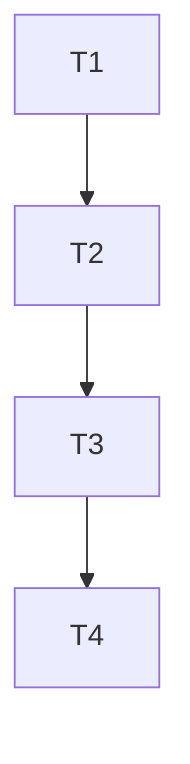

# Sustainable Tech Design System 2.0 — Tarefas

**FEATURE_ID:** `ecobi-design-system-2`  
**SPEC_VERSION:** `1.0.0`  
**STATUS:** Em andamento

## Stabilization follow-up - 2026-11-17

- T4 automated verification completed using `.venv\Scripts\python.exe`: full Pytest 35 passed; focused scheduler, Quality overflow, and Power BI tests 7 passed.
- Functional browser checks completed for navbar controls, sidebar collapse/mobile navigation/accessibility labels, scheduler create/list/status/reload/cleanup, and empty states. Manual browser checks are separate from automated tests in `verification.md`.
- Added and served the local EcoBI favicon successfully (HTTP 200). Quality overflow regression and internal table scroll remained intact.
- Limits: immediate scheduler execution was not triggered; full screen-reader/WCAG validation was not performed. No dependencies installed and no Git commit attempted.

## Plano

| ID | Entrega | Arquivos | Critério de conclusão | Estado |
|---|---|---|---|---|
| T1 | Centralizar tokens, refinamento visual, temas claro/escuro e breakpoints | `frontend/styles.css` | Tokens aplicados aos componentes e temas coerentes | Concluído |
| T2 | Refinar navegação/topbar e preservar rotas existentes | `frontend/index.html`, `frontend/app.js` | Views/IDs e seletores atuais preservados; controles acessíveis | Concluído |
| T3 | Redesenhar dashboard, KPIs e stepper com dados reais disponíveis | `frontend/index.html`, `frontend/app.js`, `frontend/styles.css` | Sem métricas ou gráficos inventados; valores indisponíveis mantêm placeholder | Concluído |
| T4 | Verificar contratos, execução, responsividade e regressão | arquivos alterados/testes existentes | Testes e inspeção registrados; limitações documentadas | Parcial — pytest e browser indisponíveis |

## Cobertura e verificações

- Fonte de testes: `AGENTS.md`, `README.md`, testes de integração em `tests/`; não existe suíte frontend nem manifest de build/lint.
- Backend/API: `python -m pytest -q` (toda a suíte existente).
- Frontend: verificar sintaxe JS, integridade de IDs/rotas e CSS disponível; validar estado visual no navegador quando disponível.
- Acessibilidade: foco visível, nomes/labels e contraste dos papéis de tokens; tema persiste sem trocar contratos.

## Test Coverage Matrix

| Code Layer | Required Test | Expected Coverage |
|---|---|---|
| Vanilla JavaScript | `node --check frontend/app.js` | Controller e atualização dos dados reais |
| HTML navigation | Script de unicidade de IDs/alvos | Doze views e destinos resolvidos |
| CSS UI | Navegador desktop/mobile, claro/escuro | Layout, tema, foco e overflow |
| API/backend | `python -m pytest -q` | Regressão dos contratos e funcionalidades existentes |

## Gate Check Commands

- `node --check frontend/app.js`
- `python -m pytest -q`
- Validadores `validate_spec.py` e `validate_tasks.py` da skill `tlc-spec-driven`.

## Execution Plan

### Phase 1

### T1: Atualizar tokens e estilos adaptáveis

Where: `frontend/styles.css`  
Depends on: none  
Tests: inspecionar tokens, temas e viewport  
Gate: componentes usam papéis semânticos e permanecem legíveis

### Phase 2

### T2: Refinar navegação e preferências

Where: `frontend/app.js`  
Depends on: T1  
Tests: `node --check frontend/app.js`; validar IDs e destinos no HTML  
Gate: preferências persistem sem alterar as 12 rotas ou contratos

### T3: Atualizar indicadores executivos

Where: `frontend/app.js`  
Depends on: T2  
Tests: conferir respostas presentes e ausentes  
Gate: KPIs e composições usam somente dados agregados existentes

### Phase 3

### T4: Auditar aplicação e registrar evidências

Where: `frontend/styles.css`  
Depends on: T1, T2, T3  
Tests: `python -m pytest -q`; inspeção visual se navegador permitir  
Gate: regressões e limitações ficam registradas

## Task Breakdown

T1–T4 descrevem entregas atômicas da evolução; mudanças de backend, contratos e modelos não estão incluídas.

## Evidence

- `node --check frontend/app.js`: aprovado.
- Validadores da skill `tlc-spec-driven`: `validate_spec` e `validate_tasks` aprovados sem avisos.
- Comparação contra `HEAD`: 12 IDs de view e 12 alvos de navegação preservados; IDs antigos mantidos e sem duplicidades.
- FastAPI: `GET /`, arquivos estáticos e `/api/health` responderam HTTP 200 no ambiente isolado.
- `pytest`: não concluiu porque o sandbox negou acesso aos diretórios temporários (`PermissionError: [WinError 5]` em `tmp_path`).
- QA visual real: navegador DevTools solicitou aprovação, indisponível sob a política atual; captura renderizada não foi validada.
- Keyboard: sidebar module received focus and Enter activated navigation, closed the mobile menu, and reset `aria-expanded` to false.
