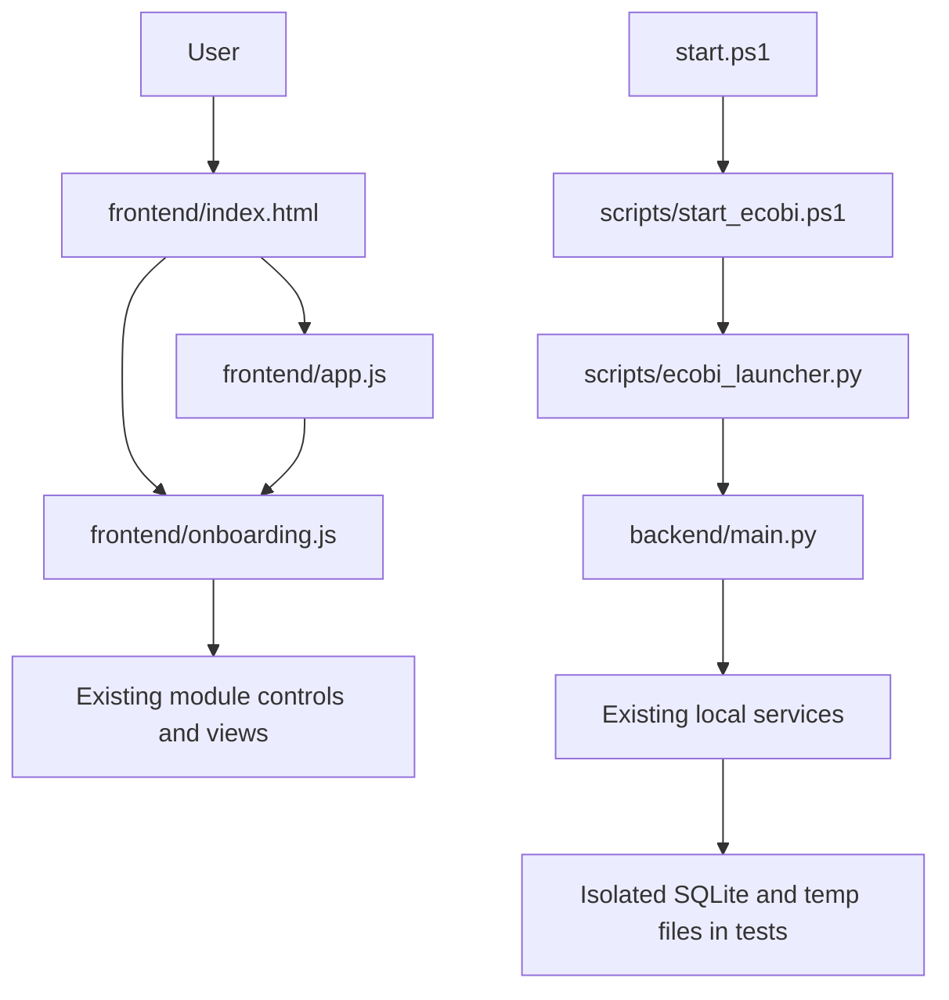

# EcoBI Finalization Design

**Spec**: `.specs/features/ecobi-finalization/spec.md`
**Status**: Approved — 2026-11-19; user approved the recommended isolated Vanilla JS onboarding controller and all remaining pending items.

## Architecture Overview

Preserve the local-first modular monolith: FastAPI serves the real twelve-view Vanilla HTML/CSS/JS application; SQLite and existing services remain the source of business state. Add onboarding as a small isolated browser controller that points at existing controls and delegates navigation to the existing application. Add a root PowerShell bootstrap entry point that delegates setup and launch to the existing scripts and Python launcher. Verification uses isolated directories/databases and synthetic fixtures only; no test points at the user database or corporate sources.

## Code Reuse Analysis

| Existing component | Location | Use |
| --- | --- | --- |
| Real module shell and controls | `frontend/index.html` | Add only onboarding entry points and accessible dialog/spotlight shell; target actual views. |
| Navigation, startup and local preference lifecycle | `frontend/app.js` | Expose a narrow view-navigation hook and initialize onboarding after existing startup checks. |
| Modern Green tokens and responsive rules | `frontend/styles.css` | Scope tour styles to onboarding and reuse current tokens, reduced-motion and focus conventions. |
| Local paths, dependency checks, FastAPI lifecycle | `scripts/ecobi_launcher.py` | Extend existing bootstrap with isolated/testable setup helpers, preserving loopback and deterministic AI fallback. |
| Existing PowerShell launcher and batch entry | `scripts/start_ecobi.ps1`, `scripts/start_ecobi.bat` | Keep compatibility; root `start.ps1` is the documented one-command entry point. |
| Existing route/service/test patterns | `backend/`, `tests/` | Add only isolated integration coverage for acceptance criteria and regression-prone module contracts. |
| Package resources | `ecobi.spec` | Ensure any added frontend controller is included by existing frontend directory bundling. |

## Components and Interfaces

### Onboarding controller
- **Purpose**: Provide first-run introduction, general/contextual spotlight tours, persistent non-sensitive progress and permanent help access.
- **Location**: `frontend/onboarding.js`, wired from `frontend/index.html` and `frontend/app.js`; styles in `frontend/styles.css`.
- **Interface**: initialize with current view and a navigation callback; expose open-intro, start-tour, next, back, defer, skip, finish, and close behavior through accessible controls.
- **Dependencies**: Existing module selectors, DOM, localStorage, and navigation hook only; no new runtime package.
- **Safety**: Tour is explanatory only; never triggers a business action or creates data. Missing targets are skipped/reported without navigation to a hidden element. Escape/close leaves the operator on the current module. Deferred intro reappears next startup; explicit skip persists version; permanent help remains available.

### Windows bootstrap entry
- **Purpose**: Support root `start.ps1` for new and existing local clones without global configuration or elevation.
- **Location**: `start.ps1` delegates to `scripts/start_ecobi.ps1`; bootstrap logic remains in `scripts/ecobi_launcher.py` and supporting scripts as justified by tests.
- **Interface**: Existing port/browser/check-only flags remain compatible; fixed loopback policy is not user-overridable. Setup is idempotent and reports actionable failures.
- **Safety**: Create/use only project `.venv`; install only declared dependencies when absent; Ollama installation/model pull is local and official-source-only when explicitly missing, with deterministic fallback if Python readiness succeeds. Never edit PATH, registry, firewall, global Ollama config, or require admin. Validate all file/process/network destinations using existing local security policy.

### Finalization evidence and regression suite
- **Purpose**: Map all active requirements and current evidence; verify module flows with isolated databases/files and label simulated, local integration and browser evidence separately.
- **Location**: `tests/`, `.specs/features/ecobi-finalization/{tasks,verification,proofs}.md`, `.specs/STATE.md`, `PLAN.md`, `README.md`, `audit-results.json`.
- **Interface**: Each requirement ID resolves to a test or explicit blocked/not-applicable reason, exact result and evidence path. User-data DB is never used for test setup or mutation.
- **Test patterns**: Pytest service/API integration with monkeypatch/temp paths; Node syntax/DOM/controller tests only if the repository has an available browser test runtime; PowerShell parser and launcher subprocess tests with isolated environment.

## Data Models

No business database schema changes. Onboarding localStorage stores a versioned, non-sensitive preference object only, such as `{version, introDismissed}`; never project data, dataset identifiers, prompts or credentials. Test records and datasets exist only under test temporary directories.

## Error Handling

| Scenario | Handling | User impact |
| --- | --- | --- |
| Spotlight target absent/hidden | Skip target and continue to a valid step; never run business actions | Tour remains usable and current view remains safe. |
| Browser storage unavailable/invalid | Keep onboarding usable in memory and show help; validate stored version/type | No application startup failure; preference may reset. |
| Python or requirements unavailable | Stop before starting server and show exact local remediation; no global install | Clear setup failure rather than misleading partial startup. |
| Ollama/model missing or setup fails | Attempt only approved local setup path; warn and retain deterministic fallback with external AI blocked | Analytics remains local; assistant reports limited mode. |
| Test DB/path/service unavailable | Mark only dependent evidence blocked/partial; continue independent checks | No false operational approval. |
| Browser approval denied / browser unavailable | Record visual UAT blocked; do not use alternate fixture as real app | Automated and non-browser work proceeds. |

## Risks & Concerns

| Concern | Evidence/location | Impact | Mitigation |
| --- | --- | --- | --- |
| Large application controller tightly owns startup and navigation | `frontend/app.js` | Tour can start before app or target hidden view | Narrow integration hooks; test lifecycle and module changes. |
| Existing `.venv`/test artifacts may be permission-sensitive | Prior `.codex-tmp` Windows temp failures; current repo has denied pytest temp tree | Tests can fail in cleanup or accidentally touch local DB | Pin TEMP/TMP/TMPDIR/pytest basetemp to `.codex-tmp`; subprocess tests explicitly set temp DB and assert isolation. |
| Current launcher resets `ECOBI_DB_PATH` before check-only | Prior C21 inspection; `scripts/ecobi_launcher.py` | Bootstrap verification might initialize the real DB | Inspect/refactor environment resolution so check-only and tests do not touch main DB; prove with timestamp/hash and isolated path. |
| Root startup entry is missing and script falls back to global Python | `start.ps1` absent; `scripts/start_ecobi.ps1` | One-command clone setup is not currently reproducible | Root wrapper and local venv setup; no global installs; test clean and repeat setup with mocked package/Ollama commands. |
| Browser DevTools tool may require unavailable approval | Prior navigation denied under never-approval policy | Required real-app visual tour proof could not run | Attempt only authorized real local app; if denied, report blocked and do not bypass. |
| `.git` is read-only | Current environment profile and prior runs | TLC atomic commits cannot be created | Preserve files, do not alter ACL; log commit gate blocked, keep task/evidence traceability in working tree. |

## Tech Decisions

| Decision | Choice | Rationale |
| --- | --- | --- |
| Onboarding boundary | Isolated Vanilla JS controller with narrow app navigation/startup hook | User approved; modular, no new dependency. |
| Browser state | Versioned localStorage preference only | Meets persistence while excluding sensitive/product data. |
| Windows startup | Root PowerShell wrapper delegates to existing supported launcher | Matches documented one-command setup while preserving architecture. |
| Environment bootstrap | Local `.venv`, local declared dependencies, no global configuration | Least privilege and reproducibility. |
| Evidence | Synthetic data + isolated SQLite/temp dirs; real local integrations only where available | No corporate data or main database mutation. |
| Git | One commit per completed task when writable; otherwise no commit and no permission bypass | `.git` currently read-only. |