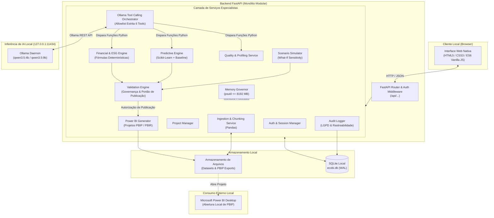
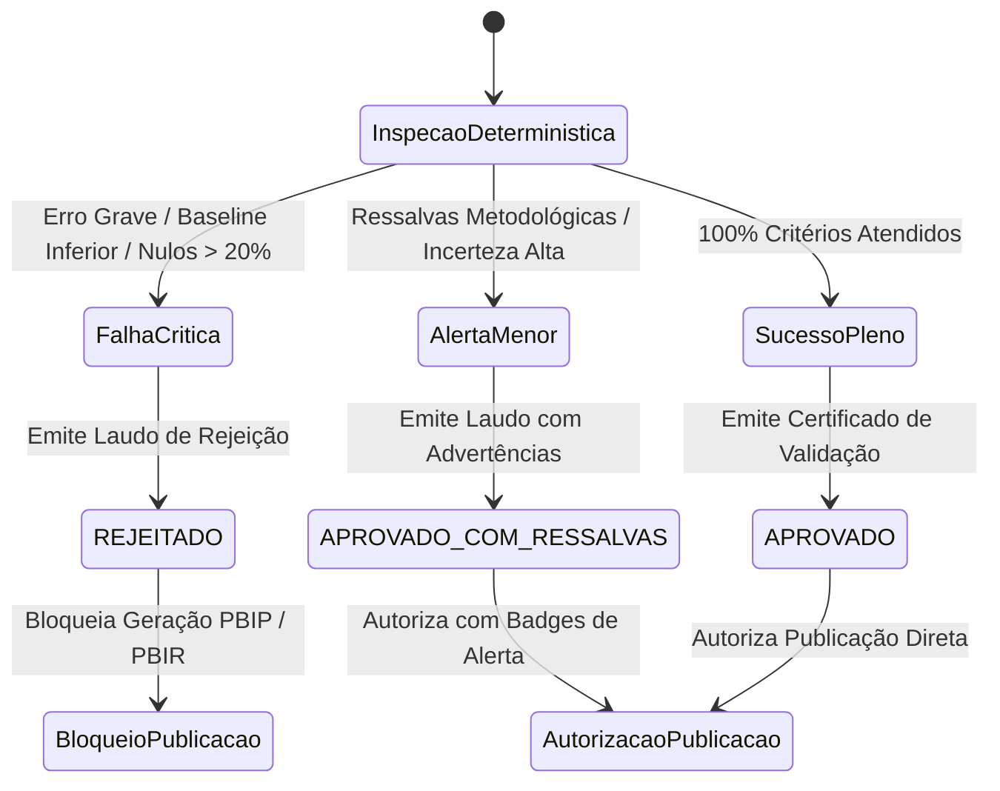

# EcoBI Intelligence MVP Design

**Spec**: `.specs/features/ecobi-mvp/spec.md`  
**Status**: Approved

---

## 1. Architecture Overview

O **EcoBI Intelligence** é concebido como uma aplicação **local-first**, modular e monolítica, estruturada em camadas bem definidas. A arquitetura foi planejada para operar estritamente dentro do orçamento máximo de 8 GB de RAM em sistemas Windows/Linux de desenvolvedores ou analistas empresariais, sem depender de microsserviços, orquestradores em nuvem ou bancos de dados distribuídos.

O fluxo de dados segue o seguinte percurso:
1. **Frontend Nativo (HTML5/CSS3/Vanilla JS)** interage com o backend via requisições REST JSON autenticadas por sessão local.
2. **FastAPI Application Core** atua como API Gateway, gerenciando autenticação local, validação Pydantic e roteamento para os serviços especialistas.
3. **Módulos Analíticos Python** executam operações determinísticas (Pandas para ETL e cálculo de KPIs financeiros/ESG; Scikit-learn para treino, teste e backtesting temporal de modelos preditivos).
4. **Assistente Local (Ollama Client)** opera como orquestrador conversacional acionando o modelo local Qwen3.5 (4B padrão, 9B condicional) através de uma allowlist estrita de exatamente 6 ferramentas, com argumentos validados antes da execução.
5. **Validation Engine** inspeciona deterministicamente a integridade dos dados, a consistência matemática e as métricas preditivas (comparadas a um naive baseline), classificando resultados em APROVADO, APROVADO_COM_RESSALVAS ou REJEITADO.
6. **BI Generator** compila projetos PBIP e relatórios PBIR abertos para o Power BI Desktop, bloqueando qualquer artefato rejeitado.
7. **SQLite Repository** persiste dados em arquivo único local com Write-Ahead Logging (WAL) ativado.
8. **Memory Governor & Audit Logger** monitoram continuamente o consumo de memória via `psutil` e mantêm log imutável de ações para conformidade com a LGPD.



---

## 2. Code Reuse Analysis

### Existing Components to Leverage

| Component | Location | How to Use |
| --- | --- | --- |
| Configuração de Ambiente | `.env.example` | Base para configurações operacionais (`ECOBI_MAX_RAM_MB`, `ECOBI_CSV_CHUNK_SIZE`, `ECOBI_OLLAMA_URL`, etc.). |
| Dependências Consolidadas | `requirements.txt` | Uso estrito dos pacotes já fixados (`fastapi`, `uvicorn`, `pydantic`, `pandas`, `scikit-learn`, `openpyxl`, `psutil`, `httpx`). |
| Papéis e Governança | `AGENTS.md` | Padrões de formatação de relatórios, isolamento de agentes e critérios de qualidade. |
| Diretrizes Conceituais | `PLAN.md` | Regras de negócio ESG (GHG Protocol), baselines preditivos e paleta de cores Sustainable Tech. |

### Integration Points

| System | Integration Method |
| --- | --- |
| Ollama Daemon | Chamadas HTTP assíncronas via `httpx.AsyncClient` para `http://127.0.0.1:11434/api/chat` com parâmetro `tools`. |
| Power BI Desktop | Geração direta de pastas e arquivos no sistema de arquivos local (`data/powerbi_exports/{project_id}/...`) seguindo especificação PBIP/PBIR v1. |
| Banco SQLite | Conexão local em `data/runtime/ecobi.db` gerenciada via módulo `sqlite3` padrão do Python, com `PRAGMA foreign_keys = ON` e `PRAGMA journal_mode = WAL`. |

---

## 3. Components & Modules

### 3.1. SessionAuthManager (`backend.auth.service`)
- **Purpose**: Controla as sessões locais autenticadas de operadores, gerencia tokens de acesso em memória/SQLite e audita o consentimento das diretrizes da LGPD.
- **Location**: `backend/auth/`
- **Interfaces**:
  - `create_session(operator_name: str, operator_email: str, lgpd_consent: bool) -> SessionTokenResponse`
  - `validate_session(token: str) -> Optional[UserSession]`
  - `terminate_session(token: str) -> bool`
- **Dependencies**: `backend.database`, `secrets`, `datetime`, `backend.audit`
- **Reuses**: Padrões de segurança local e geração criptográfica do Python (`secrets`).

### 3.2. ProjectManager (`backend.projects.service`)
- **Purpose**: Gerencia o ciclo de vida dos projetos analíticos, provendo isolamento lógico de datasets, análises e relatórios.
- **Location**: `backend/projects/`
- **Interfaces**:
  - `list_projects() -> list[ProjectSummary]`
  - `create_project(name: str, sector: str, description: Optional[str]) -> ProjectDetail`
  - `get_project(project_id: str) -> ProjectDetail`
  - `delete_project(project_id: str) -> bool`
- **Dependencies**: `backend.database`, `backend.audit`
- **Reuses**: SQLite local schema.

### 3.3. DatasetIngestionService (`backend.datasets.service`)
- **Purpose**: Realiza a leitura e gravação local de arquivos CSV e Excel com chunking de memória, inferência de codificação e tipagem.
- **Location**: `backend/datasets/`
- **Interfaces**:
  - `ingest_file(project_id: str, file_path: str, filename: str, chunk_size: int = 10000) -> DatasetInfo`
  - `get_dataset_sample(dataset_id: str, limit: int = 50) -> DatasetSample`
  - `get_dataset_metadata(dataset_id: str) -> DatasetMetadata`
- **Dependencies**: `pandas`, `openpyxl`, `chardet`, `csv`, `backend.system`
- **Reuses**: Mecanismo de chunksize do Pandas para contenção de memória <= 8 GB.

### 3.4. DataQualityProfiler (`backend.quality.service`)
- **Purpose**: Inspeciona a integridade dos dados, calcula métricas de completude, detecta duplicatas e anomalias, e registra o mapeamento para o schema canônico de negócios.
- **Location**: `backend/quality/`
- **Interfaces**:
  - `profile_dataset(dataset_id: str) -> QualityProfileReport`
  - `save_column_mapping(dataset_id: str, mapping: dict[str, str]) -> MappingConfirmation`
  - `get_column_mapping(dataset_id: str) -> dict[str, str]`
- **Dependencies**: `pandas`, `numpy`, `backend.database`
- **Reuses**: Funções de agregação e estatística do Pandas e Numpy.

### 3.5. FinancialESGAnalyticsEngine (`backend.analytics.service`)
- **Purpose**: Executa cálculos determinísticos de indicadores financeiros (faturamento, custos, EBITDA) e socioambientais (emissões de GEE Escopos 1, 2 e 3, consumo hídrico e energético) utilizando metodologias auditáveis do GHG Protocol.
- **Location**: `backend/analytics/`
- **Interfaces**:
  - `calculate_financial_kpis(dataset_id: str, date_col: str, revenue_col: str, cost_col: str) -> FinancialKPIResults`
  - `calculate_esg_kpis(dataset_id: str, mapping: dict) -> ESGKPIResults`
  - `consolidate_analysis(project_id: str, analysis_type: str, payload: dict) -> AnalysisRecord`
- **Dependencies**: `pandas`, `backend.database`, `backend.validation`
- **Reuses**: Fatores de emissão parametrizados (IPCC / GHG Protocol Brasil).

### 3.6. PredictiveEngine (`backend.predictive.service`)
- **Purpose**: Constrói modelos preditivos temporais com Scikit-learn, garantindo divisão cronológica sem vazamento de dados, mensurando MAE, RMSE, WAPE contra um baseline ingênuo e calculando intervalos de incerteza.
- **Location**: `backend/predictive/`
- **Interfaces**:
  - `train_and_predict(dataset_id: str, target_col: str, feature_cols: list[str], time_col: str, horizon: int, model_type: str = "ridge") -> PredictiveRunResult`
  - `evaluate_against_baseline(y_true: np.ndarray, y_pred: np.ndarray, y_baseline: np.ndarray) -> BenchmarkMetrics`
- **Dependencies**: `scikit-learn`, `pandas`, `numpy`, `backend.validation`
- **Reuses**: Algoritmos de regressão e séries temporais do Scikit-Learn (`Ridge`, `RandomForestRegressor`, `TimeSeriesSplit`).

### 3.7. ScenarioSimulator (`backend.simulator.service`)
- **Purpose**: Modela variações condicionais de parâmetros operacionais (ex: -10% consumo de combustível, +15% taxa de reciclagem) e projeta sensibilidade de custos e emissões evitadas.
- **Location**: `backend/simulator/`
- **Interfaces**:
  - `run_simulation(project_id: str, base_kpis: dict, variations: dict[str, float]) -> SimulationResult`
- **Dependencies**: `backend.analytics`, `backend.database`
- **Reuses**: Equações lineares e fatores de emissão do Analytics Engine.

### 3.8. OllamaAssistantOrchestrator (`backend.assistant.service`)
- **Purpose**: Conecta-se ao Ollama via REST API, mantendo histórico de conversação com limite de contexto de 4K-8K tokens e disparando ferramentas exclusivamente da allowlist fechada de 6 tools.
- **Location**: `backend/assistant/`
- **Interfaces**:
  - `process_user_message(project_id: str, message: str, conversation_history: list[dict]) -> AssistantResponse`
  - `dispatch_tool_call(project_id: str, tool_name: str, arguments: dict) -> ToolExecutionResult`
- **Dependencies**: `httpx`, `pydantic`, `backend.services.*`
- **Reuses**: API oficial de tool calling do Ollama (`/api/chat`).

### 3.9. ValidationEngine (`backend.validation.service`)
- **Purpose**: Motor determinístico de governança que valida qualidade de dados, integridade de fórmulas e desempenho preditivo antes de autorizar a exportação para o Power BI.
- **Location**: `backend/validation/`
- **Interfaces**:
  - `validate_analysis(project_id: str, analysis_id: str, analysis_type: str) -> ValidationReport`
  - `check_publication_gate(project_id: str, analysis_ids: list[str]) -> GateDecision`
- **Dependencies**: `backend.database`, `numpy`
- **Reuses**: Regras matemáticas e limiares determinísticos configurados.

### 3.10. PowerBIGenerator (`backend.powerbi.service`)
- **Purpose**: Constrói a estrutura de diretórios e arquivos JSON/TMDL do Power BI Project (PBIP) e Power BI Report (PBIR), integrando o modelo semântico tabular e medidas DAX validadas.
- **Location**: `backend/powerbi/`
- **Interfaces**:
  - `generate_pbip_project(project_id: str, analysis_ids: list[str], report_title: str) -> PBIPGenerationResult`
  - `list_generated_reports(project_id: str) -> list[PowerBIReportMeta]`
- **Dependencies**: `backend.validation`, `backend.database`, `pathlib`, `json`
- **Reuses**: Especificações oficiais da Microsoft para esquemas PBIP e PBIR.

### 3.11. AuditLogger (`backend.audit.service`)
- **Purpose**: Registra logs estruturados e imutáveis de todas as operações críticas, incluindo ingestão, execuções de modelo, validações e decisões de publicação, com hash de integridade e mascaramento de dados sensíveis para conformidade LGPD.
- **Location**: `backend/audit/`
- **Interfaces**:
  - `log_event(operator_id: str, project_id: Optional[str], action: str, details: dict, status: str) -> None`
  - `get_audit_trail(project_id: Optional[str], limit: int = 100) -> list[AuditRecord]`
- **Dependencies**: `backend.database`, `hashlib`, `datetime`
- **Reuses**: Tabelas SQLite locais.

### 3.12. MemoryGovernor (`backend.system.service`)
- **Purpose**: Monitora continuamente o consumo de memória RAM do processo EcoBI e do sistema hospedeiro via `psutil`, impondo o limite rígido de 8 GB (8192 MB) e autorizando ou bloqueando tarefas pesadas ou troca para o modelo Qwen3.5-9B.
- **Location**: `backend/system/`
- **Interfaces**:
  - `get_memory_status() -> MemoryStatusReport`
  - `assert_memory_headroom(required_mb: int = 500) -> bool`
  - `get_model_status() -> ModelSettingsResponse`
  - `switch_model(model_name: str) -> ModelSettingsResponse`
- **Dependencies**: `psutil`, `httpx`
- **Reuses**: Métricas nativas de processos do sistema operacional.

---

## 4. Data Models (SQLite Schema & DDL)

O arquivo SQLite será mantido em `data/runtime/ecobi.db`. A estrutura de tabelas relacionais assegura integridade referencial via foreign keys:

```sql
-- Habilita chaves estrangeiras e modo WAL para alta performance concorrente
PRAGMA foreign_keys = ON;
PRAGMA journal_mode = WAL;

-- Tabela de Sessões Locais / Operadores (LGPD)
CREATE TABLE IF NOT EXISTS user_sessions (
    id TEXT PRIMARY KEY,
    operator_name TEXT NOT NULL,
    operator_email TEXT NOT NULL,
    lgpd_consent INTEGER NOT NULL CHECK (lgpd_consent IN (0, 1)),
    created_at TIMESTAMP DEFAULT CURRENT_TIMESTAMP,
    expires_at TIMESTAMP NOT NULL,
    is_active INTEGER DEFAULT 1 CHECK (is_active IN (0, 1))
);

-- Tabela de Projetos
CREATE TABLE IF NOT EXISTS projects (
    id TEXT PRIMARY KEY,
    name TEXT NOT NULL UNIQUE,
    sector TEXT NOT NULL,
    description TEXT,
    created_at TIMESTAMP DEFAULT CURRENT_TIMESTAMP,
    updated_at TIMESTAMP DEFAULT CURRENT_TIMESTAMP,
    created_by TEXT NOT NULL,
    FOREIGN KEY (created_by) REFERENCES user_sessions(id)
);

-- Tabela de Datasets Ingeridos
CREATE TABLE IF NOT EXISTS datasets (
    id TEXT PRIMARY KEY,
    project_id TEXT NOT NULL,
    filename TEXT NOT NULL,
    file_path TEXT NOT NULL,
    file_size_bytes INTEGER NOT NULL,
    row_count INTEGER NOT NULL,
    column_count INTEGER NOT NULL,
    sha256_hash TEXT NOT NULL,
    created_at TIMESTAMP DEFAULT CURRENT_TIMESTAMP,
    FOREIGN KEY (project_id) REFERENCES projects(id) ON DELETE CASCADE
);

-- Tabela de Colunas e Mapeamentos dos Datasets
CREATE TABLE IF NOT EXISTS dataset_columns (
    id TEXT PRIMARY KEY,
    dataset_id TEXT NOT NULL,
    column_name TEXT NOT NULL,
    detected_type TEXT NOT NULL,
    canonical_mapping TEXT, -- Ex: 'revenue', 'cost', 'date', 'electricity_kwh', etc.
    null_count INTEGER DEFAULT 0,
    unique_count INTEGER DEFAULT 0,
    FOREIGN KEY (dataset_id) REFERENCES datasets(id) ON DELETE CASCADE,
    UNIQUE(dataset_id, column_name)
);

-- Tabela de Análises Executadas
CREATE TABLE IF NOT EXISTS analyses (
    id TEXT PRIMARY KEY,
    project_id TEXT NOT NULL,
    dataset_id TEXT NOT NULL,
    analysis_type TEXT NOT NULL, -- 'financial_esg', 'predictive', 'scenario'
    status TEXT NOT NULL,        -- 'completed', 'failed', 'running'
    created_at TIMESTAMP DEFAULT CURRENT_TIMESTAMP,
    parameters_json TEXT NOT NULL,
    results_json TEXT NOT NULL,
    FOREIGN KEY (project_id) REFERENCES projects(id) ON DELETE CASCADE,
    FOREIGN KEY (dataset_id) REFERENCES datasets(id)
);

-- Tabela de Validações e Governança
CREATE TABLE IF NOT EXISTS validations (
    id TEXT PRIMARY KEY,
    analysis_id TEXT NOT NULL,
    project_id TEXT NOT NULL,
    status TEXT NOT NULL CHECK (status IN ('APROVADO', 'APROVADO_COM_RESSALVAS', 'REJEITADO')),
    summary TEXT NOT NULL,
    rules_checked_json TEXT NOT NULL,
    caveats_json TEXT NOT NULL,
    validated_at TIMESTAMP DEFAULT CURRENT_TIMESTAMP,
    validated_by TEXT NOT NULL,
    FOREIGN KEY (analysis_id) REFERENCES analyses(id) ON DELETE CASCADE,
    FOREIGN KEY (project_id) REFERENCES projects(id) ON DELETE CASCADE
);

-- Tabela de Relatórios e Projetos Power BI Gerados
CREATE TABLE IF NOT EXISTS powerbi_reports (
    id TEXT PRIMARY KEY,
    project_id TEXT NOT NULL,
    report_title TEXT NOT NULL,
    output_dir_path TEXT NOT NULL,
    pbip_file_path TEXT NOT NULL,
    included_analyses_json TEXT NOT NULL,
    generation_status TEXT NOT NULL,
    created_at TIMESTAMP DEFAULT CURRENT_TIMESTAMP,
    FOREIGN KEY (project_id) REFERENCES projects(id) ON DELETE CASCADE
);

-- Tabela de Trilha de Auditoria Imutável (LGPD)
CREATE TABLE IF NOT EXISTS audit_logs (
    id TEXT PRIMARY KEY,
    timestamp TIMESTAMP DEFAULT CURRENT_TIMESTAMP,
    operator_id TEXT NOT NULL,
    project_id TEXT,
    action TEXT NOT NULL,
    details_json TEXT NOT NULL,
    ip_address TEXT NOT NULL DEFAULT '127.0.0.1',
    status TEXT NOT NULL
);

CREATE INDEX IF NOT EXISTS idx_audit_project ON audit_logs(project_id);
CREATE INDEX IF NOT EXISTS idx_validations_analysis ON validations(analysis_id);
CREATE INDEX IF NOT EXISTS idx_datasets_project ON datasets(project_id);
```

---

## 5. API Contracts (FastAPI Endpoints)

Todos os endpoints operam sob o prefixo `/api` e produzem/consomem `application/json` (com exceção do upload multipart). Todas as rotas autenticadas exigem o cabeçalho `Authorization: Bearer <session_token>`.

### 5.1. `/api/health`
- **Method**: `GET`
- **Description**: Verificação do status de saúde da aplicação, SQLite e conectividade com o Ollama local.
- **Request**: Sem corpo ou parâmetros.
- **Response HTTP 200**:
  ```json
  {
    "status": "healthy",
    "timestamp": "2026-11-15T18:00:00Z",
    "version": "1.0.0",
    "database": "connected",
    "ollama": {
      "status": "connected",
      "active_model": "qwen3.5:4b"
    },
    "memory_budget_mb": 8192,
    "memory_used_mb": 2150.4
  }
  ```
- **Error HTTP 503**: Serviço local degradado (ex: Ollama inacessível).

### 5.2. `/api/auth/session`
- **Method**: `POST`
- **Description**: Criação de sessão de operador com consentimento obrigatório dos termos LGPD.
- **Request Body**:
  ```json
  {
    "operator_name": "Carlos Silva",
    "operator_email": "carlos.silva@empresa.com.br",
    "lgpd_consent": true
  }
  ```
- **Response HTTP 201**:
  ```json
  {
    "session_token": "ecobi_tok_8f9a2b1c4e7d",
    "operator_name": "Carlos Silva",
    "expires_at": "2026-11-16T18:00:00Z"
  }
  ```
- **Error HTTP 422**: `lgpd_consent` é falso ou e-mail inválido.
- **Method**: `GET` (Inspecionar sessão ativa)
- **Headers**: `Authorization: Bearer <token>`
- **Response HTTP 200**:
  ```json
  {
    "session_id": "sess_12345",
    "operator_name": "Carlos Silva",
    "operator_email": "carlos.silva@empresa.com.br",
    "is_active": true,
    "created_at": "2026-11-15T18:00:00Z"
  }
  ```

### 5.3. `/api/projects`
- **Method**: `GET`
- **Description**: Lista todos os projetos disponíveis no ambiente local.
- **Response HTTP 200**:
  ```json
  [
    {
      "id": "proj_varejo_01",
      "name": "EcoVarejo Sustentável 2026",
      "sector": "Retail / E-commerce",
      "description": "Piloto TCC com dados de logística, faturamento e pegada de carbono",
      "created_at": "2026-11-15T10:00:00Z",
      "datasets_count": 2,
      "analyses_count": 4
    }
  ]
  ```
- **Method**: `POST`
- **Description**: Criação de novo projeto corporativo.
- **Request Body**:
  ```json
  {
    "name": "EcoVarejo Sustentável 2026",
    "sector": "Retail / E-commerce",
    "description": "Piloto TCC com dados de logística, faturamento e pegada de carbono"
  }
  ```
- **Response HTTP 201**: Retorna o objeto `ProjectDetail` criado.
- **Error HTTP 409**: Conflito - Projeto com mesmo nome já existe.

### 5.4. `/api/projects/{id}/datasets/upload`
- **Method**: `POST`
- **Description**: Upload multipart de arquivos `.csv`, `.xlsx` ou `.xls` para o projeto com chunking automático.
- **Parameters**: `id` (path, string)
- **Request**: `multipart/form-data` contendo campo `file`.
- **Response HTTP 201**:
  ```json
  {
    "dataset_id": "ds_9a8b7c6d",
    "project_id": "proj_varejo_01",
    "filename": "dados_operacionais_2026.csv",
    "file_size_bytes": 1425890,
    "row_count": 45000,
    "column_count": 14,
    "sha256_hash": "e3b0c44298fc1c149afbf4c8996fb92427ae41e4649b934ca495991b7852b855",
    "columns_detected": ["data_venda", "receita_bruta", "custo_operacional", "combustivel_litros", "kwh_consumido"]
  }
  ```
- **Error HTTP 400**: Extensão não suportada ou arquivo corrompido.
- **Error HTTP 413**: Arquivo excede tamanho suportado sem chunking.

### 5.5. `/api/projects/{id}/datasets/sample`
- **Method**: `GET`
- **Description**: Recupera primeiras N linhas (default 50) de um dataset do projeto para inspeção e visualização.
- **Query Params**: `dataset_id` (string, required), `limit` (int, default 50)
- **Response HTTP 200**:
  ```json
  {
    "dataset_id": "ds_9a8b7c6d",
    "total_rows": 45000,
    "columns": ["data_venda", "receita_bruta", "custo_operacional", "combustivel_litros", "kwh_consumido"],
    "rows": [
      {"data_venda": "2026-01-01", "receita_bruta": 15400.50, "custo_operacional": 9200.00, "combustivel_litros": 120.5, "kwh_consumido": 450.0},
      {"data_venda": "2026-01-02", "receita_bruta": 18200.00, "custo_operacional": 10100.00, "combustivel_litros": 135.0, "kwh_consumido": 480.0}
    ]
  }
  ```

### 5.6. `/api/projects/{id}/quality`
- **Method**: `GET`
- **Description**: Retorna métricas de perfilamento de qualidade (nulos, duplicatas, outliers, tipos) de um dataset.
- **Query Params**: `dataset_id` (string, required)
- **Response HTTP 200**:
  ```json
  {
    "dataset_id": "ds_9a8b7c6d",
    "total_rows": 45000,
    "duplicate_rows": 0,
    "columns": [
      {
        "name": "receita_bruta",
        "detected_type": "float64",
        "canonical_mapping": "financial_revenue",
        "null_count": 0,
        "null_percentage": 0.0,
        "unique_count": 12400,
        "min": 100.0,
        "max": 95000.0,
        "outliers_detected": 12
      }
    ],
    "overall_quality_score": 98.5,
    "warnings": []
  }
  ```
- **Method**: `POST`
- **Description**: Salva mapeamento das colunas do dataset para o schema canônico corporativo.
- **Request Body**:
  ```json
  {
    "dataset_id": "ds_9a8b7c6d",
    "mappings": {
      "data_venda": "date",
      "receita_bruta": "financial_revenue",
      "custo_operacional": "financial_cost",
      "combustivel_litros": "esg_scope1_fuel_liters",
      "kwh_consumido": "esg_scope2_electricity_kwh"
    }
  }
  ```
- **Response HTTP 200**: Retorna confirmação de mapeamento salvo.

### 5.7. `/api/projects/{id}/analyze/financial-esg`
- **Method**: `POST`
- **Description**: Executa o cálculo determinístico de indicadores financeiros e emissões de GEE (Escopos 1, 2 e 3) via Python/Pandas.
- **Request Body**:
  ```json
  {
    "dataset_id": "ds_9a8b7c6d",
    "period_start": "2026-01-01",
    "period_end": "2026-12-31",
    "emission_factor_source": "GHG_PROTOCOL_BRASIL_2025"
  }
  ```
- **Response HTTP 200**:
  ```json
  {
    "analysis_id": "an_fin_esg_001",
    "status": "completed",
    "financial_kpis": {
      "total_revenue": 12500000.00,
      "total_cost": 8400000.00,
      "gross_margin": 4100000.00,
      "gross_margin_percentage": 32.8
    },
    "esg_kpis": {
      "scope1_co2e_tons": 340.5,
      "scope2_co2e_tons": 185.2,
      "scope3_co2e_tons": 510.8,
      "total_emissions_co2e_tons": 1036.5,
      "carbon_intensity_kg_per_brl_revenue": 0.0829
    },
    "methodology_version": "GHG Protocol Corporate Standard v2025.1",
    "calculated_at": "2026-11-15T18:05:00Z"
  }
  ```

### 5.8. `/api/projects/{id}/analyze/predictive`
- **Method**: `POST`
- **Description**: Treina modelo preditivo em Scikit-learn com separação temporal estrita e compara com naive baseline.
- **Request Body**:
  ```json
  {
    "dataset_id": "ds_9a8b7c6d",
    "target_column": "receita_bruta",
    "time_column": "data_venda",
    "feature_columns": ["custo_operacional", "combustivel_litros", "kwh_consumido"],
    "model_type": "ridge",
    "forecast_horizon_periods": 6
  }
  ```
- **Response HTTP 200**:
  ```json
  {
    "analysis_id": "an_pred_002",
    "status": "completed",
    "metrics": {
      "model_mae": 12450.30,
      "model_rmse": 16800.45,
      "model_wape": 0.068,
      "baseline_wape": 0.124,
      "wape_improvement_pct": 45.16
    },
    "temporal_split": {
      "train_start": "2024-01-01",
      "train_end": "2025-12-31",
      "test_start": "2026-01-01",
      "test_end": "2026-06-30"
    },
    "forecast": [
      {"period": "2026-07", "predicted_value": 1150000.0, "ci_lower_90": 1080000.0, "ci_upper_90": 1220000.0},
      {"period": "2026-08", "predicted_value": 1180000.0, "ci_lower_90": 1100000.0, "ci_upper_90": 1260000.0}
    ],
    "baseline_comparison_status": "SUPERIOR_AO_BASELINE"
  }
  ```

### 5.9. `/api/projects/{id}/simulate`
- **Method**: `POST`
- **Description**: Executa simulações de cenários What-If de sensibilidade financeira e de emissões de carbono.
- **Request Body**:
  ```json
  {
    "base_analysis_id": "an_fin_esg_001",
    "variations": {
      "electricity_reduction_pct": -15.0,
      "fuel_efficiency_gain_pct": -10.0,
      "reverse_logistics_rate_pct": +20.0
    }
  }
  ```
- **Response HTTP 200**:
  ```json
  {
    "simulation_id": "sim_001",
    "project_id": "proj_varejo_01",
    "projected_cost_savings": 145000.00,
    "projected_emissions_avoided_co2e_tons": 62.3,
    "new_projected_total_emissions_co2e_tons": 974.2,
    "assumptions": [
      "Redução proporcional de 15% na fatura de eletricidade e emissões de Escopo 2",
      "Ganhos logísticos reduzem consumo de diesel em 10% (Escopo 1)"
    ]
  }
  ```

### 5.10. `/api/projects/{id}/assistant`
- **Method**: `POST`
- **Description**: Orquestrador conversacional acoplando Ollama Qwen3.5 à allowlist estrita de 6 tools locais.
- **Request Body**:
  ```json
  {
    "message": "Qual foi a nossa pegada de carbono no Escopo 1 e qual a previsão de receita para o próximo trimestre?",
    "conversation_history": [
      {"role": "user", "content": "Olá"},
      {"role": "assistant", "content": "Olá! Sou o assistente do EcoBI. Como posso ajudar com seus dados corporativos?"}
    ]
  }
  ```
- **Response HTTP 200**:
  ```json
  {
    "response": "Com base no cálculo determinístico dos seus dados, a pegada de carbono de Escopo 1 totalizou 340,5 toneladas de CO2e. Para a receita do próximo trimestre, o modelo preditivo calibrado projeta uma média de R$ 1.150.000,00/mês com intervalo de confiança entre R$ 1.080.000,00 e R$ 1.220.000,00.",
    "tools_called": [
      {
        "tool_name": "calculate_financial_esg_kpis",
        "arguments": {"project_id": "proj_varejo_01", "indicators": ["scope1_emissions", "revenue_forecast"]}
      }
    ],
    "model_used": "qwen3.5:4b"
  }
  ```

### 5.11. `/api/projects/{id}/validations`
- **Method**: `GET`
- **Description**: Retorna o parecer de validação emitido para uma análise do projeto.
- **Query Params**: `analysis_id` (string, required)
- **Response HTTP 200**:
  ```json
  {
    "validation_id": "val_98765",
    "analysis_id": "an_pred_002",
    "status": "APROVADO",
    "summary": "Análise preditiva validada com êxito. O modelo Ridge superou o baseline com WAPE de 0.068 versus 0.124 do baseline (ganho de 45.16%). Divisão temporal sem vazamento de dados.",
    "rules_checked": [
      {"rule": "data_leakage_absence", "status": "PASSED"},
      {"rule": "wape_vs_baseline", "status": "PASSED", "value": 0.068, "threshold": 0.124},
      {"rule": "minimum_time_series_length", "status": "PASSED", "points": 48}
    ],
    "caveats": [],
    "can_publish_to_powerbi": true,
    "validated_at": "2026-11-15T18:10:00Z"
  }
  ```
- **Method**: `POST`
- **Description**: Dispara reavaliação forçada pelo Validation Engine sobre uma análise.
- **Request Body**: `{"analysis_id": "an_pred_002"}`
- **Response HTTP 200**: Retorna objeto `ValidationReport` atualizado.

### 5.12. `/api/projects/{id}/powerbi/generate`
- **Method**: `POST`
- **Description**: Gera a estrutura de arquivos e pastas do projeto Power BI (.pbip e .pbir) a partir de análises aprovadas.
- **Request Body**:
  ```json
  {
    "report_title": "EcoBI - Relatório Executivo ESG & Finanças 2026",
    "analysis_ids": ["an_fin_esg_001", "an_pred_002"]
  }
  ```
- **Response HTTP 201**:
  ```json
  {
    "report_id": "pbi_rep_001",
    "report_title": "EcoBI - Relatório Executivo ESG & Finanças 2026",
    "pbip_path": "data/powerbi_exports/proj_varejo_01/EcoBI_Relatorio_2026.pbip",
    "pbir_dir": "data/powerbi_exports/proj_varejo_01/EcoBI_Relatorio_2026.Report",
    "status": "GENERATED_SUCCESSFULLY",
    "download_url": "/api/projects/proj_varejo_01/powerbi/reports/pbi_rep_001/download"
  }
  ```
- **Error HTTP 400**: Bloqueio de publicação - Uma ou mais análises selecionadas possuem status `REJEITADO` no Validation Engine.

### 5.13. `/api/projects/{id}/powerbi/reports`
- **Method**: `GET`
- **Description**: Lista relatórios PBIP/PBIR gerados para o projeto com caminhos locais e datas.
- **Response HTTP 200**:
  ```json
  [
    {
      "id": "pbi_rep_001",
      "report_title": "EcoBI - Relatório Executivo ESG & Finanças 2026",
      "pbip_path": "data/powerbi_exports/proj_varejo_01/EcoBI_Relatorio_2026.pbip",
      "created_at": "2026-11-15T18:15:00Z",
      "included_analyses": ["an_fin_esg_001", "an_pred_002"]
    }
  ]
  ```

### 5.14. `/api/projects/{id}/audit`
- **Method**: `GET`
- **Description**: Consulta os registros de auditoria e trilha de eventos vinculados ao projeto ou operador.
- **Query Params**: `limit` (int, default 100)
- **Response HTTP 200**:
  ```json
  [
    {
      "id": "aud_001",
      "timestamp": "2026-11-15T18:15:00Z",
      "operator_id": "sess_12345",
      "action": "POWERBI_PBIP_GENERATED",
      "status": "SUCCESS",
      "details": {
        "report_id": "pbi_rep_001",
        "analyses": ["an_fin_esg_001", "an_pred_002"]
      }
    }
  ]
  ```

### 5.15. `/api/system/memory`
- **Method**: `GET`
- **Description**: Retorna o consumo em tempo real de memória RAM do processo EcoBI e do host medidos via `psutil`.
- **Response HTTP 200**:
  ```json
  {
    "ecobi_ram_used_mb": 2150.4,
    "ecobi_ram_budget_mb": 8192.0,
    "ecobi_ram_usage_percentage": 26.25,
    "host_total_ram_mb": 16384.0,
    "host_available_ram_mb": 9420.0,
    "memory_alert_level": "NORMAL",
    "can_run_heavy_analysis": true
  }
  ```

### 5.16. `/api/settings/model`
- **Method**: `GET`
- **Description**: Retorna status do modelo LLM local atual no Ollama.
- **Response HTTP 200**:
  ```json
  {
    "active_model": "qwen3.5:4b",
    "available_models": ["qwen3.5:4b", "qwen3.5:9b"],
    "context_window_tokens": 4096,
    "keep_alive": "5m",
    "advanced_model_eligible": true
  }
  ```
- **Method**: `POST`
- **Description**: Altera o modelo de LLM ativo (com verificação prévia de memória livre).
- **Request Body**:
  ```json
  {
    "model_name": "qwen3.5:9b"
  }
  ```
- **Response HTTP 200**: Retorna configurações atualizadas.
- **Error HTTP 412**: Pré-condição falhou - Memória RAM livre insuficiente para carregar o modelo de 9B com segurança.

---

## 6. Ollama Tool Calling Contracts (Allowlist Estrita com 6 Tools)

O assistente local interage com o backend através da API de `/api/chat` do Ollama. As chamadas de ferramentas são restritas a exatamente 6 tools descritas no schema JSON padronizado abaixo. O backend inspeciona os argumentos com Pydantic antes de qualquer execução e impede qualquer execução fora da allowlist.

### Tool 1: `profile_dataset_quality`
- **Function**: Avalia a qualidade do dataset, retornando porcentagem de nulos, tipos de colunas e anomalias.
- **Schema JSON**:
  ```json
  {
    "type": "function",
    "function": {
      "name": "profile_dataset_quality",
      "description": "Examina a estrutura e qualidade dos dados de um dataset, calculando métricas de integridade, valores nulos, duplicatas e distribuição.",
      "parameters": {
        "type": "object",
        "properties": {
          "project_id": {"type": "string", "description": "ID do projeto"},
          "dataset_id": {"type": "string", "description": "ID do dataset"},
          "sample_size": {"type": "integer", "description": "Número de linhas amostradas para perfilamento rápido", "default": 1000}
        },
        "required": ["project_id", "dataset_id"]
      }
    }
  }
  ```

### Tool 2: `calculate_financial_esg_kpis`
- **Function**: Executa o cálculo determinístico de indicadores financeiros e emissões de GEE (Escopos 1, 2 e 3).
- **Schema JSON**:
  ```json
  {
    "type": "function",
    "function": {
      "name": "calculate_financial_esg_kpis",
      "description": "Calcula deterministicamente indicadores de faturamento, custos, margens e emissões de CO2 equivalente (Escopos 1, 2 e 3) com base em fatores oficiais.",
      "parameters": {
        "type": "object",
        "properties": {
          "project_id": {"type": "string", "description": "ID do projeto"},
          "dataset_id": {"type": "string", "description": "ID do dataset"},
          "indicators": {
            "type": "array",
            "items": {"type": "string"},
            "description": "Lista de indicadores a calcular: 'revenue', 'costs', 'scope1', 'scope2', 'scope3'"
          }
        },
        "required": ["project_id", "dataset_id", "indicators"]
      }
    }
  }
  ```

### Tool 3: `run_predictive_model`
- **Function**: Treina modelo preditivo em Scikit-learn com split temporal e backtesting vs baseline.
- **Schema JSON**:
  ```json
  {
    "type": "function",
    "function": {
      "name": "run_predictive_model",
      "description": "Treina um modelo preditivo com divisão temporal cronológica e avalia métricas MAE, RMSE e WAPE comparadas a um naive baseline.",
      "parameters": {
        "type": "object",
        "properties": {
          "project_id": {"type": "string", "description": "ID do projeto"},
          "target_col": {"type": "string", "description": "Coluna alvo para previsão"},
          "feature_cols": {"type": "array", "items": {"type": "string"}, "description": "Colunas explicativas"},
          "model_type": {"type": "string", "enum": ["ridge", "random_forest", "linear"], "default": "ridge"},
          "horizon": {"type": "integer", "description": "Número de períodos à frente a projetar", "default": 6}
        },
        "required": ["project_id", "target_col", "feature_cols"]
      }
    }
  }
  ```

### Tool 4: `simulate_scenario`
- **Function**: Modela cenários de sensibilidade What-If para custos e pegada de carbono.
- **Schema JSON**:
  ```json
  {
    "type": "function",
    "function": {
      "name": "simulate_scenario",
      "description": "Simula cenários What-If operacionais aplicando variações percentuais sobre parâmetros de energia, combustível e demanda.",
      "parameters": {
        "type": "object",
        "properties": {
          "project_id": {"type": "string", "description": "ID do projeto"},
          "base_analysis_id": {"type": "string", "description": "ID da análise financeira/ESG base"},
          "parameter_variations": {
            "type": "object",
            "description": "Dicionário de variações percentuais ex: {'electricity_pct': -10.0, 'fuel_pct': -5.0}"
          }
        },
        "required": ["project_id", "base_analysis_id", "parameter_variations"]
      }
    }
  }
  ```

### Tool 5: `validate_analysis_results`
- **Function**: Submete uma análise ao Validation Engine determinístico para obter o parecer de governança.
- **Schema JSON**:
  ```json
  {
    "type": "function",
    "function": {
      "name": "validate_analysis_results",
      "description": "Avalia deterministicamente os resultados analíticos ou preditivos, classificando-os em APROVADO, APROVADO_COM_RESSALVAS ou REJEITADO.",
      "parameters": {
        "type": "object",
        "properties": {
          "project_id": {"type": "string", "description": "ID do projeto"},
          "analysis_id": {"type": "string", "description": "ID da análise a ser auditada"},
          "analysis_type": {"type": "string", "enum": ["financial_esg", "predictive", "scenario"]}
        },
        "required": ["project_id", "analysis_id", "analysis_type"]
      }
    }
  }
  ```

### Tool 6: `generate_powerbi_pbip`
- **Function**: Constrói o projeto Power BI PBIP/PBIR local a partir de análises validadas.
- **Schema JSON**:
  ```json
  {
    "type": "function",
    "function": {
      "name": "generate_powerbi_pbip",
      "description": "Gera os arquivos de projeto PBIP e relatórios PBIR do Power BI Desktop com base nas análises aprovadas pelo motor de validação.",
      "parameters": {
        "type": "object",
        "properties": {
          "project_id": {"type": "string", "description": "ID do projeto"},
          "analysis_ids": {"type": "array", "items": {"type": "string"}, "description": "IDs das análises a incluir no relatório"},
          "report_title": {"type": "string", "description": "Título do relatório no Power BI"}
        },
        "required": ["project_id", "analysis_ids", "report_title"]
      }
    }
  }
  ```

---

## 7. Validation Engine Contracts & Governance Rules

O motor de validação é estritamente determinístico. A validação opera em 4 categorias de testes e emite um dos três estados possíveis:



### 7.1. Regras de Qualidade de Dados
- **REG-QUAL-01 (Completude Mínima)**: Se as colunas obrigatórias mapeadas tiverem mais de 10% de valores nulos, emite `APROVADO_COM_RESSALVAS`. Se exceder 20%, status é `REJEITADO`.
- **REG-QUAL-02 (Duplicidade Crítica)**: Se linhas duplicadas idênticas ultrapassarem 5% do total de registros, status é `APROVADO_COM_RESSALVAS`.

### 7.2. Regras Financeiras e Matemáticas
- **REG-FIN-01 (Consistência de Margens)**: Receita Bruta >= 0. Custo Operacional >= 0. Se `Receita < Custo`, emite alerta de prejuízo operacional (`APROVADO_COM_RESSALVAS`), mas mantém consistência matemática.
- **REG-FIN-02 (Valores Negativos Inválidos)**: Se grandezas físicas (litros de combustível, kWh de eletricidade) possuírem valores negativos, status é `REJEITADO`.

### 7.3. Regras de Desempenho Preditivo
- **REG-PRED-01 (Superação do Baseline)**:
  $$\text{WAPE}(\text{modelo}) = \frac{\sum |y_i - \hat{y}_i|}{\sum |y_i|}$$
  O WAPE do modelo treinado deve ser inferior ao WAPE do naive baseline (persistência do último valor ou média móvel).
  - Se $\text{WAPE}_{\text{modelo}} \ge \text{WAPE}_{\text{baseline}}$, o modelo preditivo é imediatamente classificado como `REJEITADO`.
- **REG-PRED-02 (Divisão Cronológica)**: É mandatório que o conjunto de teste suceda temporalmente o conjunto de treino. Qualquer overlap de datas gera `REJEITADO` por data leakage.
- **REG-PRED-03 (Histórico Mínimo)**: A série temporal deve conter no mínimo 24 observações cronológicas. Abaixo disso, o resultado é `REJEITADO`.

### 7.4. Regras Metodológicas ESG (GHG Protocol)
- **REG-ESG-01 (Segregação de Escopos)**: Emissões de Escopo 1 (combustão móvel/estacionária direta), Escopo 2 (eletricidade adquirida) e Escopo 3 (resíduos, transporte contratado) não podem ser somadas sem permitir desagregação individual.
- **REG-ESG-02 (Créditos de Carbono)**: É terminantemente proibido abater créditos de carbono ou compensações de terceiros diretamente do montante de emissões brutas geradas. Qualquer tentativa de compensação direta acarreta status `REJEITADO`.
- **REG-ESG-03 (Versão dos Fatores)**: Os fatores de conversão devem possuir fonte documentada e versão válida (ex: Fatores Médicos MCTI / GHG Protocol Brasil).

### 7.5. Política de Execução e Bloqueio
- **Bloqueio Hard**: Qualquer tentativa de invocar `/api/projects/{id}/powerbi/generate` incluindo um `analysis_id` com status `REJEITADO` resulta em código HTTP 400 imediato, impedindo a compilação do PBIP.

---

## 8. UI Specifications (10 Priority Screens)

A interface é construída em **HTML5, CSS3 moderno e Vanilla JavaScript (ES6 Modules)**, aplicando a paleta **Sustainable Tech** oficial:
- Verde Floresta (Primário / Header): `#183A32`
- Verde Natural (Acentos / Botões de Ação): `#4F7A59`
- Verde Menta (Bordas / Destaques / Badges Sucesso): `#B9D6C2`
- Verde Sálvia (Fundo de Cards / Menus Laterais): `#DCE8D9`
- Off-White (Fundo Geral da Aplicação): `#F5F6F0`
- Terracota (Alertas / Erros / Badges Rejeitado): `#C8784A`

### Tela 1: Login & Sessão Local (Operador e Consentimento LGPD)
- **Objetivo**: Identificar o analista/operador responsável e registrar consentimento explícito dos termos de tratamento local e privacidade de dados.
- **Componentes**:
  - Modal/Card centralizado em `#F5F6F0` com cabeçalho em `#183A32`.
  - Campos de entrada: Nome do Operador, E-mail Corporativo.
  - Caixa de seleção (checkbox) obrigatória: "Declaro ciência de que os dados serão processados localmente e concordo com os termos de governança e LGPD".
  - Botão "Iniciar Sessão Segura" em `#4F7A59`.
- **Estados**:
  - *Vazio*: Botão desabilitado até preenchimento de campos válidos.
  - *Processando*: Spinner minimalista.
  - *Erro*: Borda e mensagem em `#C8784A` caso o termo não seja marcado.

### Tela 2: Gestão de Projetos (Dashboard de Projetos)
- **Objetivo**: Listar, pesquisar, criar e alternar entre projetos corporativos.
- **Componentes**:
  - Barra superior de busca e filtro por setor industrial.
  - Grid responsivo de cards de projeto em `#DCE8D9` com contadores de datasets, análises e relatórios gerados.
  - Botão "+ Novo Projeto" abrindo modal de cadastro (Nome, Setor, Descrição).
  - Status do projeto (Ativo / Arquivado).
- **Interações**: Clicar em um card seleciona o projeto ativo e redireciona para a visão geral.

### Tela 3: Importação de Datasets (Upload & Chunking)
- **Objetivo**: Permitir o upload local de arquivos CSV e Excel com visualização do progresso de leitura em blocos.
- **Componentes**:
  - Área de drag-and-drop para arquivos `.csv`, `.xlsx`, `.xls`.
  - Tabela de datasets já importados com nome do arquivo, tamanho, contagem de linhas e hash SHA-256.
  - Barra de progresso de ingestão em `#4F7A59` com monitoramento de chunks para arquivos grandes (> 10 MB).
  - Botões de ação por dataset: "Visualizar Amostra", "Verificar Qualidade", "Remover".

### Tela 4: Qualidade e Mapeamento de Dados (Profiling & Mapping)
- **Objetivo**: Exibir o diagnóstico de qualidade das colunas ingeridas e mapear as variáveis para os conceitos de negócio.
- **Componentes**:
  - Painel de score geral de qualidade (0-100%).
  - Tabela detalhada de colunas exibindo: Nome Original, Tipo Detectado, % Nulos, Valores Únicos, Contagem de Outliers.
  - Dropdown em cada linha para associar a coluna ao schema canônico (`financial_revenue`, `financial_cost`, `date`, `esg_scope1_fuel_liters`, `esg_scope2_electricity_kwh`, `esg_scope3_waste_kg`).
  - Botão "Salvar e Validar Mapeamento".

### Tela 5: Análise Financeira & ESG Descritiva (KPIs & Escopos GEE)
- **Objetivo**: Exibir os resultados consolidados de receitas, custos, margens e a pegada de carbono desagregada por Escopo 1, 2 e 3.
- **Componentes**:
  - Cards de KPIs no topo: Receita Total, Custos, Margem Bruta, Emissões Totais de CO2e.
  - Gráfico de barras (CSS puro/SVG) comparando emissões por escopo (Escopo 1 vs Escopo 2 vs Escopo 3).
  - Painel de intensidade de carbono ($kg\text{ CO}_2\text{e} / R\$\text{ faturado}$).
  - Tabela com fatores de emissão aplicados e versão metodológica do GHG Protocol.

### Tela 6: Análise Preditiva & Backtesting (Modelos ML & Baseline)
- **Objetivo**: Configurar e avaliar modelos de regressão para variáveis financeiras e ambientais com backtesting rigoroso.
- **Componentes**:
  - Painel de seleção de hiperparâmetros: Variável Alvo, Features Preditivas, Tipo de Modelo (Ridge / Random Forest), Horizonte (meses).
  - Painel comparativo de métricas: WAPE Modelo vs WAPE Baseline, MAE, RMSE e percentual de melhoria sobre o baseline.
  - Gráfico de linha temporal com valores históricos (realizados), previsões futuras e faixa sombreada de incerteza (percentis 10%-90%).
  - Badge de status: Verde se superou baseline, Terracota (`#C8784A`) se rejeitado.

### Tela 7: Simulador de Impacto & Cenários What-If
- **Objetivo**: Ajustar controles deslizantes (sliders) e simular variações de sustentabilidade e finanças.
- **Componentes**:
  - Sliders interativos de variação:
    - Variação no consumo de energia elétrica (-50% a +20%)
    - Eficiência no consumo de combustíveis (-50% a +20%)
    - Aumento na taxa de logística reversa e reciclagem (0% a +100%)
  - Painel de impacto dinâmico: Economia projetada (R$) e Toneladas de CO2e evitadas.
  - Lista de premissas condicionais explícitas.
  - Botão "Salvar Cenário para o Power BI".

### Tela 8: Central de Validação & Governança (Auditoria & Aprovação)
- **Objetivo**: Inspecionar os laudos detalhados emitidos pelo Validation Engine sobre cada análise.
- **Componentes**:
  - Lista de análises executadas com seus respectivos selos de aprovação: `APROVADO` (verde `#4F7A59`), `APROVADO_COM_RESSALVAS` (âmbar), `REJEITADO` (terracota `#C8784A`).
  - Painel expansível contendo a lista de regras testadas (data leakage, baseline WAPE, completude, segregação de escopos).
  - Seção de ressalvas e advertências operacionais.
  - Indicador do Portão de Publicação: Permite ou bloqueia a inclusão no Power BI.

### Tela 9: Geração & Exportação Power BI (PBIP/PBIR)
- **Objetivo**: Configurar e compilar o projeto do Power BI Desktop com base nos dados validados.
- **Componentes**:
  - Seleção de análises aprovadas a serem incluídas no relatório.
  - Bloqueio visual com tooltip explicativo caso alguma análise selecionada esteja com status `REJEITADO`.
  - Campo de Título do Relatório Executivo.
  - Botão "Gerar Projeto Power BI (.pbip)".
  - Card de sucesso contendo o caminho absoluto do arquivo no disco local e botão de download do pacote compactado.

### Tela 10: Auditoria, LGPD & Monitoramento do Sistema
- **Objetivo**: Painel administrativo para acompanhamento de uso de recursos da máquina e trilha de auditoria.
- **Componentes**:
  - Medidor de RAM EcoBI (Gauge / Barra horizontal) em tempo real: Consumo Atual (MB) vs Teto de 8192 MB com indicação via `psutil`.
  - Status do LLM Ollama: Modelo em uso (`qwen3.5:4b` ou `qwen3.5:9b`), latência média e botão de alternância de modelo (habilitado apenas se houver RAM livre suficiente).
  - Tabela da trilha de auditoria contendo Timestamp, Operador, Ação Realizada e Status.
  - Botão "Exportar Relatório de Conformidade LGPD".

---

## 9. Security, LGPD & Memory Budget (<= 8GB) Management

### 9.1. Gestão e Restrição de Memória (Budget de 8192 MB)
- **Monitoramento em Tempo Real**: O módulo `MemoryGovernor` utiliza `psutil.Process().memory_info().rss` somado à memória residente dos subprocessos e do Ollama para calcular o consumo real em MB.
- **Chunking Pandas Obrigatório**: Arquivos CSV com mais de 10.000 linhas são lidos exclusivamente com o argumento `chunksize=10000`, processando agregações iterativamente sem carregar DataFrames gigantescos na memória.
- **Política de 1 Único LLM**: O backend nunca instancia múltiplos modelos concorrentemente. Parâmetro `keep_alive=5m` descarrega a memória do Ollama quando inativo.
- **Janela de Contexto**: O contexto de inferência é fixado estritamente entre 4096 e 8192 tokens (`num_ctx=4096`), prevenindo o crescimento descontrolado da KV-cache da GPU/RAM.
- **Portão de Admissão de Tarefas**: Se o consumo do EcoBI atingir 7168 MB (87.5% de 8192 MB), novas tarefas pesadas de treino de ML são enfileiradas ou rejeitadas preventivamente com status HTTP 503.

### 9.2. Privacidade por Design e Conformidade LGPD
- **Isolamento de Rede**: O backend bloqueia expressamente qualquer comunicação com endpoints externos de IA. A variável `ECOBI_BLOCK_EXTERNAL_AI=true` impede conexões para domínios de terceiros.
- **Pseudonimização e Mascaramento de PII**: Quaisquer colunas identificadas com dados pessoais (nomes, CPFs, e-mails de clientes) sofrem mascaramento SHA-256 local com salt antes de qualquer apresentação analítica ou exportação para o Power BI.
- **Trilha de Auditoria Imutável**: Todas as ações de ingestão, visualização, cálculo, validação e exportação geram registros não editáveis na tabela `audit_logs` do SQLite.

---

## 10. Error Handling Strategy

| Cenário de Erro | Código HTTP | Tratamento pelo Backend | Impacto e Mensagem para o Usuário |
| --- | --- | --- | --- |
| Arquivo de upload corrompido ou formato não suportado | 400 Bad Request | Aborta parsing, remove arquivo temporário e não persiste dataset. | "Arquivo inválido ou corrompido. Utilize apenas arquivos CSV ou Excel estruturados." |
| Token de sessão ausente, expirado ou inválido | 401 Unauthorized | Rejeita requisição no middleware de autenticação. | "Sessão expirada ou não autenticada. Por favor, identifique-se na tela inicial." |
| Projeto com nome duplicado | 409 Conflict | Interrompe criação no banco SQLite e preserva dados preexistentes. | "Já existe um projeto com este nome no workspace local." |
| Tentativa de exportar análise rejeitada para Power BI | 400 Bad Request | O serviço `PowerBIGenerator` checa o parecer no banco e aborta a compilação. | "Bloqueio de governança: O relatório contém análises rejeitadas pelo motor de validação." |
| Invocação de ferramenta fora da allowlist pela LLM | 422 Unprocessable | Intercepta tool call, registra incidente na auditoria e devolve prompt corretivo. | "Ação não autorizada pelo assistente. O sistema opera apenas com ferramentas autorizadas." |
| Esgotamento iminente do orçamento de RAM (> 7168 MB) | 503 Service Unavailable | Bloqueia novas rotinas pesadas de machine learning para evitar OOM fatal. | "Memória temporariamente sobrecarregada. Aguarde a finalização das tarefas anteriores." |
| Ollama Daemon desconectado ou inativo | 503 Service Unavailable | Timeout de 60s ativado; retorna status de serviço degradado. | "O serviço local do Ollama não está respondendo. Verifique se o daemon está em execução." |

---

## 11. Risks & Concerns

| Preocupação / Risco | Localização | Impacto | Mitigação Arquitetural |
| --- | --- | --- | --- |
| Consumo de memória pelo Power BI Desktop além do EcoBI | Processo Windows externo | O Power BI Desktop roda como processo independente e pode consumir 2-4 GB de RAM. | O orçamento de 8 GB é restrito aos processos do EcoBI, deixando 8 GB livres em máquinas de 16 GB; relatórios PBIP usam modelos colunares compactados. |
| Modelo Qwen3.5-4B alucinar formato de parâmetros no tool calling | `backend/assistant/service.py` | Chamadas de funções com tipos incorretos poderiam quebrar o backend. | Validação prévia estrita via esquemas Pydantic antes de despachar a chamada para a função Python determinística. |
| Séries temporais muito curtas para divisão treino/teste | `backend/predictive/service.py` | Overfitting severo ou impossibilidade de calcular métricas de backtesting. | Regra determinística no Validation Engine que rejeita previsões com menos de 24 pontos históricos. |
| Sobrecarga de I/O em arquivos CSV massivos | `backend/datasets/service.py` | Travamento da thread principal durante leitura de grandes arquivos. | Leitura em chunks assíncronos no Pandas e salvamento do progresso por blocos no banco local. |

---

## 12. Tech Decisions

| Decisão Arquitetural | Opção Escolhida | Justificativa Técnica |
| --- | --- | --- |
| Estrutura de Monólito Modular Local-First | Python + FastAPI + SQLite | Evita latência e overhead de microsserviços, simplifica instalação para o TCC e garante que 100% dos dados permaneçam locais. (Ref: AD-001) |
| Gestão de Orçamento de Memória | Máximo 8 GB RAM monitorado via `psutil` | Permite rodar conjuntamente com o Power BI Desktop em estações típicas de 16 GB de RAM. (Ref: AD-002) |
| Governança Determinística | Validation Engine com APROVADO, APROVADO_COM_RESSALVAS e REJEITADO | Elimina a subjetividade de LLMs na aprovação de dados e garante conformidade com o GHG Protocol. (Ref: AD-003) |
| Tool Calling com Allowlist Fechada | Exatamente 6 ferramentas tipadas | Garante que o modelo de linguagem apenas planeje ações e que nenhum cálculo crítico seja executado pela IA generativa. (Ref: AD-004) |
| Exportação em Formato Aberto Power BI | Projetos PBIP e relatórios PBIR | Formato moderno baseado em texto/JSON, nativo do Power BI Desktop, permitindo versionamento e auditoria sem custos de cloud. (Ref: AD-005) |
| Privacidade e Conformidade LGPD | Bloqueio de APIs externas de IA e logs de auditoria | Protege dados empresariais sensíveis contra vazamento em conformidade com a Lei nº 13.709/2018. (Ref: AD-006) |
