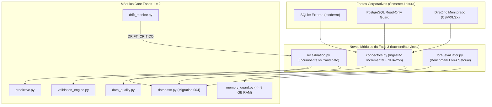

# EcoBI Intelligence — Fase 3: Arquitetura e Design Técnico (`ecobi-phase3`)

**Feature ID**: `ecobi-phase3`  
**Spec**: `.specs/features/ecobi-phase3/spec.md`  
**Status**: `Approved`

---

## 1. Visão Arquitetural Incremental

A Fase 3 estende a arquitetura monolítica modular *local-first* (`FastAPI + SQLite WAL + Pandas/Scikit-learn + Ollama Local + Vanilla HTML/CSS/JS`) sem introduzir frameworks externos proibidos e mantendo o consumo de RAM estritamente `<= 8192 MB`:

---

## 2. Modelo de Dados — `MIGRATION_004_SQL` (`backend/database.py`)

1. **Tabela `data_connectors`**:
   - `id TEXT PRIMARY KEY` (`conn_<hex>`)
   - `project_id TEXT NOT NULL REFERENCES projects(id) ON DELETE CASCADE`
   - `name TEXT NOT NULL`
   - `connector_type TEXT NOT NULL CHECK (connector_type IN ('sqlite_external', 'postgresql_readonly', 'watched_directory'))`
   - `config_json TEXT NOT NULL DEFAULT '{}'` (credenciais/senhas sempre mascaradas antes de persistir)
   - `query_or_table TEXT NOT NULL DEFAULT ''`
   - `watermark_column TEXT DEFAULT 'periodo'`
   - `last_watermark_value TEXT`
   - `last_source_sha256 TEXT`
   - `status TEXT NOT NULL DEFAULT 'ACTIVE' CHECK (status IN ('ACTIVE', 'PAUSED', 'ERROR'))`
   - `created_by TEXT`
   - `created_at TEXT NOT NULL`
   - `updated_at TEXT NOT NULL`

2. **Tabela `connector_ingestion_runs`**:
   - `id TEXT PRIMARY KEY` (`run_<hex>`)
   - `connector_id TEXT NOT NULL REFERENCES data_connectors(id) ON DELETE CASCADE`
   - `project_id TEXT NOT NULL REFERENCES projects(id) ON DELETE CASCADE`
   - `dataset_id TEXT REFERENCES datasets(id) ON DELETE SET NULL`
   - `run_status TEXT NOT NULL CHECK (run_status IN ('SUCCESS', 'NO_CHANGES', 'SCHEMA_ERROR', 'SECURITY_BLOCKED', 'FAILED'))`
   - `rows_discovered INTEGER NOT NULL DEFAULT 0`
   - `rows_ingested INTEGER NOT NULL DEFAULT 0`
   - `source_sha256 TEXT`
   - `previous_watermark TEXT`
   - `new_watermark TEXT`
   - `schema_validation_json TEXT NOT NULL DEFAULT '{}'`
   - `error_message TEXT`
   - `executed_by TEXT`
   - `created_at TEXT NOT NULL`

3. **Tabela `recalibration_proposals`**:
   - `id TEXT PRIMARY KEY` (`recal_<hex>`)
   - `project_id TEXT NOT NULL REFERENCES projects(id) ON DELETE CASCADE`
   - `drift_report_id TEXT REFERENCES drift_reports(id) ON DELETE SET NULL`
   - `dataset_id TEXT REFERENCES datasets(id) ON DELETE SET NULL`
   - `target_column TEXT NOT NULL`
   - `incumbent_analysis_id TEXT REFERENCES analyses(id) ON DELETE SET NULL`
   - `candidate_analysis_id TEXT REFERENCES analyses(id) ON DELETE SET NULL`
   - `candidate_validation_id TEXT REFERENCES validations(id) ON DELETE SET NULL`
   - `incumbent_wape REAL NOT NULL DEFAULT 0.0`
   - `candidate_wape REAL NOT NULL DEFAULT 0.0`
   - `wape_improvement_pct REAL NOT NULL DEFAULT 0.0`
   - `validation_status TEXT NOT NULL`
   - `governance_status TEXT NOT NULL CHECK (governance_status IN ('PROPOSTA_PENDENTE', 'PROMOVIDO_APROVADO', 'REJEITADO_GOVERNANCA', 'BLOQUEADA_VALIDACAO'))`
   - `comparison_report_json TEXT NOT NULL DEFAULT '{}'`
   - `decided_by TEXT`
   - `decided_at TEXT`
   - `created_at TEXT NOT NULL`

4. **Tabela `lora_evaluations`**:
   - `id TEXT PRIMARY KEY` (`lora_<hex>`)
   - `project_id TEXT REFERENCES projects(id) ON DELETE SET NULL`
   - `sector TEXT NOT NULL`
   - `adapter_name TEXT NOT NULL`
   - `base_model TEXT NOT NULL`
   - `evaluation_status TEXT NOT NULL CHECK (evaluation_status IN ('APTO_EXPERIMENTAL', 'REPROVADO_QUALIDADE', 'BLOCKED_INSUFFICIENT_RAM'))`
   - `tool_accuracy_pct REAL NOT NULL DEFAULT 0.0`
   - `domain_fidelity_score REAL NOT NULL DEFAULT 0.0`
   - `deterministic_alignment_score REAL NOT NULL DEFAULT 0.0`
   - `latency_ms REAL NOT NULL DEFAULT 0.0`
   - `ram_used_mb REAL NOT NULL DEFAULT 0.0`
   - `ram_peak_mb REAL NOT NULL DEFAULT 0.0`
   - `metrics_json TEXT NOT NULL DEFAULT '{}'`
   - `limitations_json TEXT NOT NULL DEFAULT '[]'`
   - `executed_by TEXT`
   - `created_at TEXT NOT NULL`

---

## 3. Regras de Segurança e Governança

1. **Guarda Somente-Leitura Inviolável (`connectors.py`)**:
   - `validate_readonly_query(sql_or_table)` bloqueia qualquer token DDL/DML (`INSERT`, `UPDATE`, `DELETE`, `DROP`, `ALTER`, `TRUNCATE`, `CREATE`, `REPLACE`, `GRANT`, `REVOKE`, `ATTACH`, `DETACH`, `PRAGMA`, `COPY`, `EXEC`, `;` multi-statement).
   - Conexões SQLite externas utilizam `sqlite3.connect(f"file:{resolved_path}?mode=ro", uri=True)` + `PRAGMA query_only = ON;`.
   - Conexões PostgreSQL operam em sessão `SET SESSION CHARACTERISTICS AS TRANSACTION READ ONLY;` e nunca persistem senhas em texto claro (`password` / `dsn` são mascarados via `mask_connector_config()`).
2. **Separação Estrita de Modelos na Recalibração (`recalibration.py`)**:
   - Nenhuma proposta de recalibração substitui automaticamente o modelo incumbente.
   - Candidatos cujo parecer no `Validation Engine` seja `REJEITADO` nascem com `governance_status = "BLOQUEADA_VALIDACAO"` e não podem ser promovidos nem mesmo manualmente (`HTTP 422`).
3. **Orçamento de 8 GB de RAM e Bloqueio Controlado LoRA (`lora_evaluator.py`)**:
   - Verifica `memory_guard.get_memory_status()` antes de carregar/avaliar o adaptador. Se `ecobi_ram_used_mb + adapter_overhead_mb > 8192.0` (ou `host_available_ram_mb < required_free_ram_mb`), registra `BLOCKED_INSUFFICIENT_RAM` sem causar falha no processo.

---

## 4. Contratos de API da Fase 3 (`backend/main.py`)

| Método & Rota | Papel RBAC | Descrição |
|---|---|---|
| `POST /api/projects/{project_id}/connectors` | `admin`, `analyst` | Registra conector somente-leitura (`sqlite_external`, `postgresql_readonly`, `watched_directory`) |
| `GET /api/projects/{project_id}/connectors` | Autenticado | Lista conectores do projeto (com credenciais mascaradas) |
| `POST /api/projects/{project_id}/connectors/{connector_id}/sync` | `admin`, `analyst` | Executa ingestão incremental somente-leitura, validação de schema e criação de dataset |
| `GET /api/projects/{project_id}/connectors/runs` | Autenticado | Lista histórico de execuções de ingestão incremental e linhagem SHA-256 |
| `POST /api/projects/{project_id}/recalibrations/propose` | `admin`, `analyst`, `validator` | Executa proposta controlada de recalibração preditiva a partir de alerta de drift |
| `GET /api/projects/{project_id}/recalibrations` | Autenticado | Lista propostas de recalibração do projeto (incumbente vs candidato vs promovido) |
| `POST /api/projects/{project_id}/recalibrations/{proposal_id}/decide` | `admin`, `validator` | Aprova (promove) ou rejeita proposta de recalibração respeitando o Validation Engine |
| `POST /api/system/lora/evaluate` | `admin`, `analyst` | Executa pipeline local de avaliação experimental de adaptador LoRA setorial |
| `GET /api/system/lora/evaluations` | Autenticado | Lista avaliações experimentais de adaptadores LoRA registradas |
