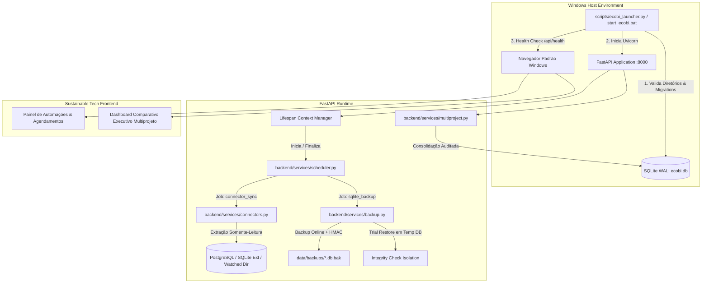

# EcoBI Intelligence — Design Técnico da Fase 4 (`ecobi-phase4`)

**Feature ID**: `ecobi-phase4`  
**Spec Version**: `4.0.0`  
**Status**: `Draft`  
**Data**: 2026-11-15  

---

## 1. Arquitetura de Componentes da Fase 4

A Fase 4 introduz três blocos arquiteturais modulares integrados ao monólito local-first:



---

## 2. Modelo de Dados — Migration 006 (`MIGRATION_006_SQL`)

Para persistir agendamentos operacionais e o histórico de execuções, é criada a Migration 006 em `backend/database.py`:

```sql
-- 006_phase4_scheduler_multiproject.sql

-- Agendamento de rotinas operacionais (sincronização de conectores e backup online)
CREATE TABLE IF NOT EXISTS scheduled_jobs (
    id TEXT PRIMARY KEY,
    name TEXT NOT NULL,
    job_type TEXT NOT NULL CHECK(job_type IN ('connector_sync', 'sqlite_backup', 'data_quality_audit')),
    project_id TEXT REFERENCES projects(id) ON DELETE CASCADE,
    connector_id TEXT REFERENCES data_connectors(id) ON DELETE CASCADE,
    interval_minutes INTEGER NOT NULL DEFAULT 60,
    is_active INTEGER NOT NULL DEFAULT 1,
    max_retries INTEGER NOT NULL DEFAULT 3,
    retention_days INTEGER DEFAULT 30,
    max_backups INTEGER DEFAULT 10,
    last_run_at TEXT,
    next_run_at TEXT,
    last_status TEXT CHECK(last_status IN ('SUCCESS', 'FAILED', 'NO_CHANGES', 'SKIPPED_LOCKED', NULL)),
    last_error TEXT,
    created_by TEXT NOT NULL DEFAULT 'system',
    created_at TEXT NOT NULL,
    updated_at TEXT NOT NULL
);

CREATE INDEX IF NOT EXISTS idx_scheduled_jobs_type ON scheduled_jobs(job_type);
CREATE INDEX IF NOT EXISTS idx_scheduled_jobs_active ON scheduled_jobs(is_active);
CREATE INDEX IF NOT EXISTS idx_scheduled_jobs_project ON scheduled_jobs(project_id);

-- Histórico de execuções dos jobs agendados
CREATE TABLE IF NOT EXISTS job_execution_logs (
    id TEXT PRIMARY KEY,
    job_id TEXT NOT NULL REFERENCES scheduled_jobs(id) ON DELETE CASCADE,
    job_type TEXT NOT NULL,
    project_id TEXT REFERENCES projects(id) ON DELETE SET NULL,
    status TEXT NOT NULL CHECK(status IN ('RUNNING', 'SUCCESS', 'FAILED', 'NO_CHANGES', 'SKIPPED_LOCKED')),
    started_at TEXT NOT NULL,
    completed_at TEXT,
    duration_ms REAL,
    records_processed INTEGER DEFAULT 0,
    summary_json TEXT NOT NULL DEFAULT '{}',
    error_message TEXT,
    triggered_by TEXT NOT NULL DEFAULT 'scheduler'
);

CREATE INDEX IF NOT EXISTS idx_job_execution_logs_job ON job_execution_logs(job_id);
CREATE INDEX IF NOT EXISTS idx_job_execution_logs_status ON job_execution_logs(status);
CREATE INDEX IF NOT EXISTS idx_job_execution_logs_started ON job_execution_logs(started_at);
```

---

## 3. Especificação do Agendador Local (`backend/services/scheduler.py`)

- **Design de Baixo Acoplamento**: Roda em loop cooperativo `asyncio` em background task ativada no `lifespan` do FastAPI.
- **Prevenção de Execuções Concorrentes**: Mantém um `set` em memória (`_active_locks`) protegendo cada job ou conector individualmente. Se uma sincronização demorada estiver em andamento, novas execuções simultâneas para o mesmo conector são marcadas como `SKIPPED_LOCKED`.
- **Controle de Falhas e Retry**:
  - Em caso de exceção de rede ou I/O, aplica retry controlado com backoff exponencial (1s, 2s, 4s).
  - Em caso de falha persistente, registra em `job_execution_logs` com erro sanitizado e notifica no dashboard de auditoria.
- **Restauração de Teste em Isolamento (`verify_and_restore_backup_trial`)**:
  - Toda rotina de backup periódico invoca a restauração experimental em banco SQLite temporário isolado (`tempfile.NamedTemporaryFile`).
  - Executa `PRAGMA integrity_check;`, confere as tabelas essenciais (`projects`, `users`, `audit_logs`) e apaga o arquivo temporário, atestando conformidade com a política de desastre e recuperação.

---

## 4. Especificação do Dashboard Multiprojeto (`backend/services/multiproject.py`)

- **Estrutura de Agregação**:
  - Consolida indicadores a partir de `datasets`, `analyses` e `canonical_mappings` de múltiplos projetos autorizados para o usuário.
  - **Métricas Financeiras**: Receita Total (Soma dos faturamentos reconciliados), Margem Operacional Média ponderada, OPEX Total.
  - **Métricas ESG**: Emissões Totais de GEE (tCO2e), decompostas em Escopo 1 (combustíveis e emissões diretas), Escopo 2 (energia elétrica adquirida) e Escopo 3 (logística e resíduos).
  - **Intensidade de Carbono**: $\frac{\text{Emissões Totais (tCO2e)}}{\text{Receita Líquida (R\$ Milhão)}}$.
  - **Governança Anti-Greenwashing**: Compensações por créditos de carbono (`carbon_credits_tco2e`) são exibidas em campo estritamente segregado, nunca abatendo as emissões brutas da organização.
  - **Linhagem dos Dados**: Cada métrica é acompanhada de `data_origin` (`REAL` para bases financeiras/ESG validadas pelo Validation Engine; `ESTIMADO` para cenários preditivos e simulações).
- **Isolamento de Projetos e RBAC**:
  - A API filtra projetos com base no usuário logado: operadores e analistas visualizam apenas os projetos aos quais estão associados; administradores e validadores corporativos possuem visão consolidada global.

---

## 5. Arquitetura de Empacotamento Windows (`ECOBI-20`)

- **Launcher Python (`scripts/ecobi_launcher.py`)**:
  - Verifica integridade do ambiente.
  - Garante a criação de `data/runtime`, `data/logs`, `data/backups`, `data/exports`.
  - Configura logging rotacionado para console e arquivo `data/logs/ecobi.log`.
  - Inicia Uvicorn em subprocesso ou thread controlada.
  - Executa polling em `http://127.0.0.1:8000/api/health` (timeout 30s).
  - Abre o navegador padrão na URL `http://127.0.0.1:8000`.
  - Monitora o processo e intercepta `KeyboardInterrupt` / `SIGTERM` para encerramento limpo.
- **Scripts de Bootstrap Windows**:
  - `scripts/start_ecobi.bat`: Atalho executável duplo-clique para operadores em ambientes Windows corporativos sem terminal aberto.
  - `scripts/start_ecobi.ps1`: Script PowerShell assinado/estruturado com parâmetros de porta e modo de execução.
- **Especificação PyInstaller (`ecobi.spec`)**:
  - Empacota o backend FastAPI, templates, arquivos estáticos da interface (`frontend/`), esquemas de validação e bibliotecas locais em diretório autocontido (`onedir`) ou executável único.
- **Manual de Operação**:
  - Criado em `docs/windows_deployment.md`.
