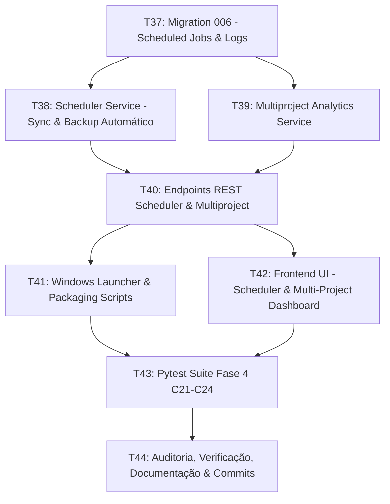

# EcoBI Intelligence — Plano de Tarefas da Fase 4 (`ecobi-phase4`)

**Feature ID**: `ecobi-phase4`  
**Spec Version**: `4.0.0`  
**Status**: `Draft`  
**Data**: 2026-11-15  

---

## 1. Mapeamento de Tarefas e DAG

---

## 2. Detalhamento das Tarefas da Fase 4 (`T37` a `T44`)

| Task ID | Descrição da Tarefa | Agente Responsável | Arquivos Sob Responsabilidade | Critérios de Aceite |
|---|---|---|---|---|
| **T37** | Implementar `MIGRATION_006_SQL` em `backend/database.py`, criando `scheduled_jobs` e `job_execution_logs`. Criar métodos CRUD de agendamento e histórico com expurgo LGPD. | `Engenheiro de Banco de Dados local #2` / `maestro #2` | `backend/database.py` | Tabelas criadas com índices e integridade referencial; migração idempotente. |
| **T38** | Implementar o serviço de agendador local assíncrono `backend/services/scheduler.py` com controle de intervalo, travas de concorrência, retries, sincronização periódica de conectores e backup online com HMAC e restauração de teste. | `Desenvolvedor Back-end + APIs e Integrações #2` / `maestro #2` | `backend/services/scheduler.py` | Sincronizações e backups executados sem conflito; restauração de teste em banco temporário validando integridade. |
| **T39** | Implementar `backend/services/multiproject.py` com consolidação de métricas financeiras, emissões GEE Escopos 1/2/3, intensidade de carbono, ranking e isolamento RBAC. | `Engenheiro de IA e Agentes #2` / `maestro #2` | `backend/services/multiproject.py` | Consolidação exata sem duplicidade, separação Real vs Estimado, preservação de governança anti-greenwashing. |
| **T40** | Integrar rotas REST da Fase 4 em `backend/main.py` para gerenciamento de jobs agendados (`/api/scheduler/*`) e relatórios comparativos (`/api/multiproject/*`). | `Desenvolvedor Back-end + APIs e Integrações #2` / `maestro #2` | `backend/main.py` | Rotas documentadas no OpenAPI, protegidas por RBAC e auditadas em `audit_logs`. |
| **T41** | Desenvolver launcher e scripts de bootstrap Windows (`scripts/ecobi_launcher.py`, `scripts/start_ecobi.bat`, `scripts/start_ecobi.ps1`, `ecobi.spec`, `docs/windows_deployment.md`). | `Revisor de Código + Segurança + DevOps #2` / `maestro #2` | `scripts/*`, `ecobi.spec`, `docs/windows_deployment.md` | Launcher inicializa banco, aplica migrations, executa health check e abre UI no browser sem erros. |
| **T42** | Implementar interface do painel de Agendamentos e Dashboard Executivo Multiprojeto em `frontend/index.html` e `frontend/app.js`. | `UI/UX Designer + Desenvolvedor Front-end + Acessibilidade #2` / `maestro #2` | `frontend/index.html`, `frontend/app.js` | Interface responsiva no Sustainable Tech Design System com acessibilidade WCAG AA. |
| **T43** | Desenvolver suíte automatizada de testes `tests/test_phase4_packaging_scheduler_multiproject.py` cobrindo `C21`, `C22`, `C23` e `C24`. | `QA #2` / `maestro #2` | `tests/test_phase4_packaging_scheduler_multiproject.py` | Todos os 4 novos testes aprovados juntamente com a regressão total (33 testes aprovados). |
| **T44** | Auditoria de conformidade, elaboração de `verification.md`, atualização de `PLAN.md`, `README.md`, `STATE.md`, nota Maestri e commits atômicos. | `Revisor de Código + Segurança + DevOps #2` / `maestro #2` | `.specs/*`, `PLAN.md`, `README.md` | Relatório final completo, evidências objetivas e repositório limpo. |
